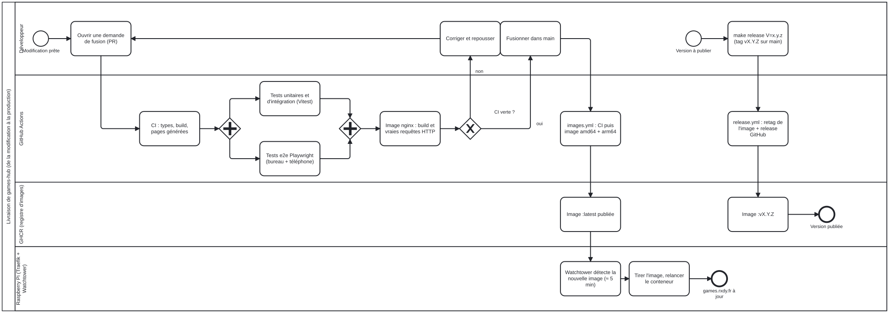

# games-hub — games.rxdy.fr

Le hub qui réunit les jeux de Rudy : une page d'accueil avec un bandeau par jeu, et une page de présentation
par jeu avec un lien pour y jouer. **Ce site ne contient aucun jeu** et n'a pas de backend : ce sont des pages
statiques, générées à la compilation.

Vue 3 + Vite + [vite-ssg](https://github.com/antfu-collective/vite-ssg) (une vraie page HTML par route, utile
pour le référencement et les aperçus de liens), servies par nginx dans un conteneur.

## Lancer en local

```bash
make up        # http://localhost:8081
make down
```

Rien à installer à part Docker : le build tourne dans un conteneur Node 22.

## Structure du front

Composants découpés en **atomes** (un élément, aucune logique : bouton, pastille, lien…), **molécules** (quelques
atomes assemblés : section, carte, liste…) et **organismes** (blocs de page : en-tête, bandeau de jeu, héros…).
Les vues ([`src/views/`](src/views)) ne font que les composer. Chaque composant a son style (`<style scoped>`) et son
test (`*.test.ts`) dans son fichier : pas de feuille CSS à part, sauf les variables et la base dans
[`App.vue`](src/App.vue).

```
src/components/atoms/       BaseLink, BaseButton, BackLink, BrandMark, SkipLink, StatusBadge, TagChip, LeadText, GameMotif
src/components/molecules/   BrandLink, PageSection, PageHero, ProseBlock, FeatureCard, FeatureList, TagList, GameTeaser
src/components/organisms/   SiteHeader, SiteFooter, GameBand, GameBandList, GameHero, OtherGames
```

## Tests

| Niveau | Commande | Ce qui est testé |
|---|---|---|
| Unitaires | `npm run test:unit` | Chaque composant isolément, les données des jeux, les balises de page |
| Intégration | `npm run test:integration` | Le vrai routeur et toutes les vues ensemble : navigation, pages inconnues, bouton « Jouer » |
| E2E | `npm run test:e2e` | Le site compilé dans Chromium, **bureau et téléphone** : parcours, pas de débordement, SEO, clavier |
| Image | `make image` | L'image nginx réellement servie : codes HTTP, redirections, en-têtes de sécurité |

`npm test` lance unitaires + intégration, `make e2e` compile puis lance les e2e (première fois :
`npx playwright install chromium`). `npm run captures` enregistre une capture de chaque page, bureau et téléphone,
dans `captures/`.

## Ajouter ou modifier un jeu

Tout le contenu est dans [`src/data/games.ts`](src/data/games.ts) : titre, accroche, description, points forts,
technos, état (`en-ligne` / `en-developpement`) et adresse du jeu (`url`).

Pour un nouveau jeu : ajouter une entrée dans ce fichier, puis un motif (petit dessin SVG) dans
[`src/components/GameMotif.vue`](src/components/GameMotif.vue), et l'adresse dans `public/sitemap.xml`.
Pour Duck, renseigner `url` et passer `status` à `en-ligne` quand il sera jouable : le bouton « Jouer » apparaît.

## CI/CD et releases

Même chemin que les autres projets (`traintracks`, `queens`, `portfolio`) : GitHub construit l'image, GHCR la
stocke, Watchtower la déploie sur le Pi.

| Événement | Workflow | Ce qui se passe |
|---|---|---|
| Demande de fusion | [`ci.yml`](.github/workflows/ci.yml) | Types, compilation, pages générées (une par jeu, accueil, 404), puis l'image servie par nginx et de vraies requêtes |
| Fusion dans `main` | [`images.yml`](.github/workflows/images.yml) | La CI, puis l'image `amd64` + `arm64` publiée sur `ghcr.io/rxdy/games-hub` en `latest`. Watchtower la déploie sur le Pi (vérification toutes les 5 minutes). |
| Tag `vX.Y.Z` | [`release.yml`](.github/workflows/release.yml) | L'image de ce commit reçoit le tag de version (jamais reconstruite), et une release GitHub est créée avec le site compilé en archive |

Publier une version :

```bash
make release V=1.0.0     # tag v1.0.0 sur main ; la CI fait le reste
```

`make release` refuse si on n'est pas sur `main`, si des modifications ne sont pas commitées, si `main` n'est pas
identique à `origin/main`, ou si le tag existe déjà. Une version se pose toujours sur ce qui est déjà en production.

Vérifier en local ce que vérifie la CI : `make check`.

### Schéma du processus



Source BPMN 2.0 : [`docs/bpmn/livraison.bpmn`](docs/bpmn/livraison.bpmn) (ouvrable dans [bpmn.io](https://demo.bpmn.io)).

## Mise en ligne (Raspberry Pi, Traefik)

Le DNS `*.rxdy.fr` et Traefik sont déjà en place (voir le dépôt `infra`). Sur le Pi, il suffit du fichier
[`docker-compose.prod.yml`](docker-compose.prod.yml) : l'image vient de GHCR, rien n'est compilé sur le Pi.

```bash
# sur le Pi, une seule fois
docker login ghcr.io          # seulement si l'image GHCR est privée
make prod                     # ou : TAG=v1.0.0 make prod  pour une version précise
```

Ensuite, chaque fusion dans `main` met le site à jour sans rien faire (Watchtower).

Le portfolio (`rxdy.fr`) renvoie vers ce hub ; le hub renvoie vers le portfolio (en-tête et pied de page).

## Style

Une seule DA pour tout le site, palette reprise du portfolio, thème clair ou sombre selon le système.
Les couleurs sont des variables CSS en tête de [`src/style.css`](src/style.css).
